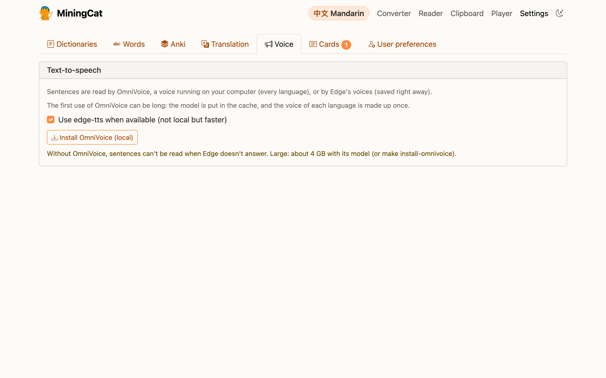
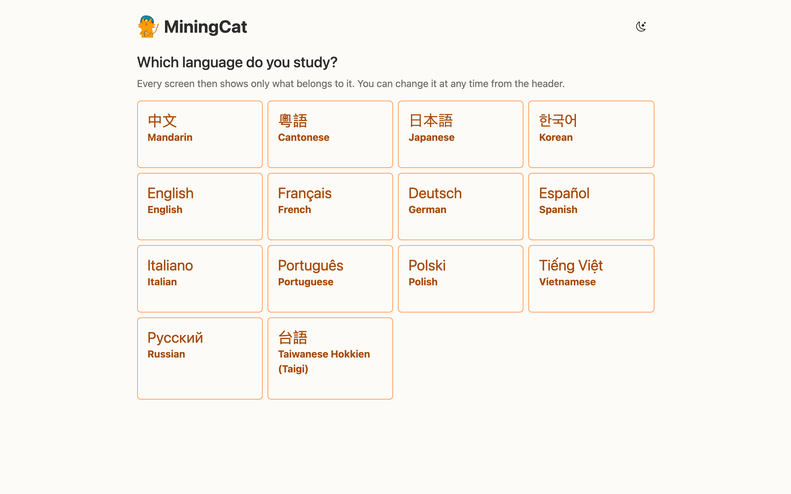
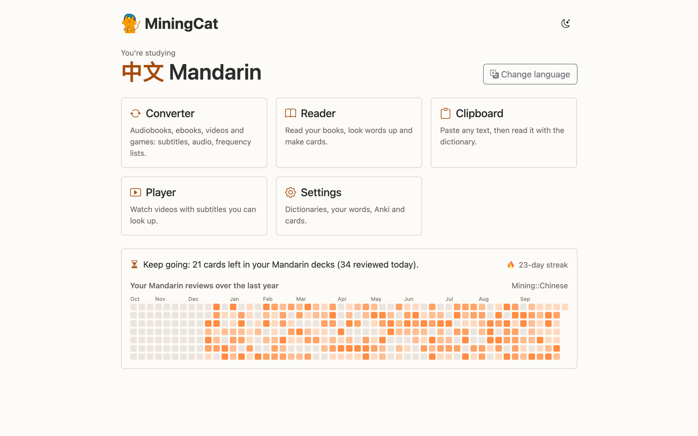
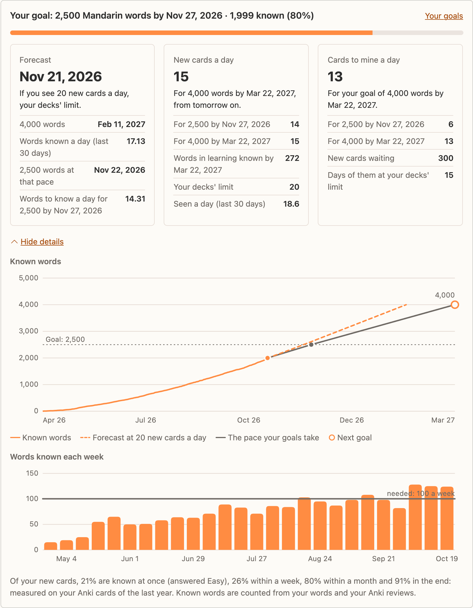
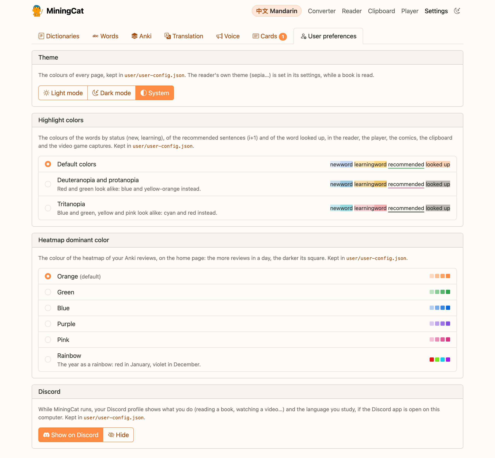

# Getting started
!!! warning
    Currently, there's not executable files for this project. Installation requires to use the terminal.

## Requirements

- **Python** 3.14 (the version used in CI; tested with 3.14.5)
- **ffmpeg**, used to split, convert and render audio and video
    - macOS: `brew install ffmpeg`
    - Debian/Ubuntu: `sudo apt install ffmpeg`
    - Windows: see [Installation on Windows](#installation-on-windows)
- **A web browser**: the GUI is a local web page (nothing is sent online)
- **make**, to use the shortcuts below (you can also call `python -m miningcat` directly, see [CLI reference](cli.md))

Everything else (Whisper, yt-dlp, edge-tts, OpenCC, [owocr](https://pypi.org/project/owocr/)...) is installed by `make install`.
The local voice reading the sentences and the books, [OmniVoice](https://github.com/k2-fsa/OmniVoice), is large: install
it from Settings › Voice (Install OmniVoice), or with `make install-omnivoice` (about 4 GB with its model, in its own
environment `.venv-omnivoice`). The first use can be long: the model is put in the cache, and each language's voice is made up once.

 Settings › Voice also sets its quality. edge-tts is used by default (faster, but online): once OmniVoice is installed,
OmniVoice takes over when Edge fails (a message tells you), and reads everything if you untick "Use edge-tts when available".

### ElevenLabs (optional, paid)

[ElevenLabs](https://elevenlabs.io) can read with a voice of your choice (e.g. one with the accent you're learning), using
your own account's credits. In **Settings › Voice › ElevenLabs**:

1. Paste an API key (ElevenLabs › Developers › API keys) with the permissions **Text to Speech**, **Models: read** and
   **User: read** (**Voices: read** as well, to show the voice's name). A free account can't use the voices of the voice
   library through the API: a paid plan is needed for them. The key is kept encrypted in the database, with the key
   file `user/secret.key`: moving MiningCat to another computer, take it along with `library/`, or paste the API key
   again.
2. Pick the model (the list comes from your account). *Latest* (the default) is ElevenLabs' latest model that reads
   the language, the newer one as soon as ElevenLabs releases it.
3. Paste the ID of the voice reading the language you study: find a voice in the
   [voice library](https://elevenlabs.io/app/voice-library), then *Copy voice ID*.

Its voice is then offered in every voice list (the card creator, *CSV to cards*, the converter's *Generate audio*), after
the others: it only reads what you pick it for. Tick **Use ElevenLabs as the main voice** to have it read every sentence
without audio of the cards you make (and every word without a recording) and be the converter's first voice: each
character read uses credits, and the audio isn't generated once they run out. The text in square brackets (the
readings of `字[zi4]`) is never sent: the recent models would read it as audio tags.

## Installation

```bash
git clone https://github.com/linlin56/mining-cat.git
cd mining-cat

# Create and activate a virtual environment
python3 -m venv .venv
source .venv/bin/activate      # Windows: .venv\Scripts\activate

# Install the dependencies
make install
```

!!! tip
    The Makefile automatically uses `.venv/bin/python3` when it exists, so `make` commands work even if you forget to activate the environment.

!!! note "macOS 26.0 to 26.2"
    If you're on macOS 26.0, 26.1 or 26.2 and Python installed with Homebrew doesn't work (`Symbol not found: _XML_SetAllocTrackerActivationThreshold`),
    it's a [Homebrew issue](https://github.com/Homebrew/homebrew-core/issues/277330). Install Python another way, then recreate the environment:

    - the installer from [python.org](https://www.python.org/downloads/macos/), then `rm -rf .venv && python3.14 -m venv .venv`
    - or [uv](https://docs.astral.sh/uv/):

        ```bash
        uv python install 3.14
        rm -rf .venv && uv venv --python 3.14 --seed .venv
        ```

    Then `make install` as usual.

### Installation on Windows

Windows doesn't come with `make`, Python 3.14 or ffmpeg. The simplest way to get them is [Chocolatey](https://chocolatey.org/install), a package manager for Windows.

1. Open **PowerShell as administrator** (right-click on PowerShell › *Run as administrator*), and install Chocolatey by following [its guide](https://chocolatey.org/install#individual).
2. In the same window, install the tools:

    ```powershell
    choco install git make python314 ffmpeg -y
    ```

3. Close PowerShell and open a new one, **not** as administrator this time (the new window sees the newly installed tools). Then:

    ```powershell
    git clone https://github.com/linlin56/mining-cat.git
    cd mining-cat

    make venv       # creates .venv with Python 3.14
    make install    # installs the dependencies in .venv
    make gui
    ```

The Makefile uses `.venv\Scripts\python.exe` when it exists: no need to activate the environment.

!!! tip "Without make"
    Every `make` command is a shortcut for a Python command (see [CLI reference](cli.md)). In PowerShell, from the `mining-cat` folder:

    ```powershell
    py -3.14 -m venv .venv
    .venv\Scripts\python.exe -m pip install -r requirements.txt
    .venv\Scripts\python.exe -m pip install --no-deps "owocr>=1.26.8"

    $env:PYTHONPATH = "src"
    .venv\Scripts\python.exe -m miningcat.interfaces.web --port 5050
    ```

    Don't forget the `owocr` line: it isn't in `requirements.txt` (it's installed apart, without its dependencies), and the [video game](video-game.md) OCR needs it. `$env:PYTHONPATH` only lasts as long as the PowerShell window: set it again in a new one.

## Launch the GUI

```bash
make gui
```

MiningCat starts a small local server and opens the GUI in your browser at <http://127.0.0.1:5050/>. Keep the terminal open while you use it, and press `Ctrl+C` there to stop it. Use `make gui PORT=8080` if the port is already taken.

### Choose the language you study

The home page first asks which language you study. Every screen then only shows what belongs to it: the converter's variants, the books of the reader, the videos of the player, and in the settings the dictionaries, words, Anki decks and cards of that language. Change it at any time with the language badge in the header of every page, which brings you back to the home page.



From the home page, open the **Converter**, the [Reader](reader.md), the [Player](player.md) or the **Settings**.
When Anki is open (with AnkiConnect), the home page also shows, under the screens, where your reviews stand today
(not started, cards left, or done), your streak of days in a row with reviews, and a heatmap of your reviews in the
current year (its buttons go to the years before, when they have reviews). Only the decks linked to the language you study count (with their subdecks): the deck its cards go
to and the decks synced with its words, in **Settings › Anki**. Your other decks (maths...) don't.



### Vocabulary goals

Set a goal in **Settings › User preferences › Vocabulary goals**: "I want to know 5000 words by June 1st". Until you
do, the home page invites you to, under the heatmap. Then it shows, for the goal with the nearest date (set several for
milestones along the way), three counts. The figures they come from are folded under them: **Show details** unfolds
the three at once (your browser remembers it).

- the **forecast**: the day you'll get there if you see your decks' limit of new cards a day, from the words you have
  in learning and the new cards to come. Its details: the forecast of your other goals, the words that became known
  a day over the last 30 days and the day you'd get there at that pace, and the words to know a day the goal takes.
  Without Anki, the date at your current pace;
- the **new cards a day** to see in Anki from tomorrow on, next to your decks' limit (raise it in Anki when it's
  lower) and the new cards you actually saw a day over the last 30 days. Its details: the count of each goal, and the
  words in learning that should be known by the goal's date, and later;
- the **cards to mine a day**, once the new cards already waiting in Anki (and the cards made in MiningCat but not sent
  yet) are counted, and how many days they last at your decks' limit. Its details: the count of each goal;
- a chart of your known words over time, with the forecast (dashed) and the line your goals take (to the nearest goal,
  then from one goal to the next), and a chart of the words known each week.



With several goals to come, the new cards and the cards to mine a day are the ones that reach them all: those of the
most demanding goal, named under the count. Enough cards for the nearest goal don't make them 0 while the next goals
need more. A goal counts **known words**, not cards: a word is known once its card's interval reaches the known
interval of **Settings › Anki** (21 days by default), so the new cards and the cards still in learning of your decks
aren't known words yet.

A new card isn't always known weeks after you first see it: a word you already knew, answered Easy, is known at once;
most take weeks, some never get there. MiningCat measures it on your Anki cards of the last year: the share of new
cards known within each number of days (a card not known yet only tells that it takes it longer than its age, so the
recent cards don't skew it), told under the charts. The forecast and the counts use it for the new cards to come, and
for each word in learning, from how long ago you first saw it: one seen long ago and still not known is a hard one,
with less of a chance. Until you've reviewed enough cards (or without Anki), they count with usual values: a delay
before a card is known, and the share of cards that get there; the shaded days before the goal's date in the chart are
then too late for new cards. The history of your known words comes from your Anki reviews (the day a card reached the
known interval), from the words you marked known yourself, and from the number of known words MiningCat records each
day it syncs with Anki or shows the goal. Marking known the words you already know counts them at once.

A goal is **reached** on the first day you know enough words, before its date: it gets a filled point on the chart, on
that day, and the home page congratulates you for two weeks. A goal whose date passes first is **missed**: it gets a
hollow point on its date, above the number of words you knew that day, and the home page tells you when you'll get
there at your current pace. Either way, the goal stays in the list of **Settings › User preferences**, as the history
of your goals (delete it there), and the nearest goal still to come takes over.

The **Settings** have a tab per topic: **Dictionaries** (import a dictionary or a frequency list), **Words**, **Anki**, **Translation**, **Cards** (the cards waiting for Anki) and **User preferences**: the theme (light, dark, or your system's), the highlight colours (with palettes for colour blindness), the colour of the heatmap of reviews (orange, green, blue, purple, pink, or a rainbow along the year), the vocabulary goals and the Discord status. The moon button in the header of every page also switches between light and dark.



While MiningCat runs, your Discord profile shows what you do in it ("Reading a book", "Watching a video", "Playing" and the [source name](video-game.md) of a game...) and the language you study, with your Anki streak once the home page got it ("Japanese · 🔥 12-day streak"), if the Discord app is open on the same computer. Turn it off in **Settings › User preferences › Discord**.

You can drag and drop files on the audio, book and video panels. The files you pick are copied into the project's `sources/` folder, like before.

The converter's header has three settings shared by every workflow:

| Setting        | What it does                                                                                                                        |
| -------------- | ----------------------------------------------------------------------------------------------------------------------------------- |
| **Source**     | `Audiobook / Ebook`, `Video` or `Video game / Screen share`. Picks which screen you're working with.                                |
| **Variant**    | Only when the language studied has several (Mandarin: Taiwan or China, English: US or UK). It drives transcription, punctuation fixes, TTS voices and subtitle metadata. |
| **Convert to** | Only for Chinese variants: converts subtitles between simplified and traditional characters (e.g. read a mainland book in traditional). |

Then pick your workflow:

- [Audiobooks & ebooks](audiobook-ebook.md): one video per chapter, from a book and/or its audiobook.
- [Videos](video.md): subtitles for a YouTube, Instagram or Bilibili video, or a video file on your computer.
- [Video games & screen share](video-game.md): OCR the text of a game window, and mine it from a web page.

When you're done, the videos are in `output/final/`. Open them in MiningCat's [video player](player.md), or in any player you like, and start mining!

## Accepted inputs

| Input      | Formats                                                      |
| ---------- | ------------------------------------------------------------ |
| Ebook      | `.epub` (recommended), `.txt` (one or several files)         |
| Audiobook  | `.m4b` (split with its chapter markers), `.mp3`, `.m4a`, `.aac`, `.ogg`, `.wav`, `.flac`, `.opus` (one file per chapter) |
| Video      | A URL from a [supported platform](video.md#from-the-web), or any local video file ffmpeg can read |
| Video game | Any window on screen ([Linux and macOS](video-game.md#supported-systems)) |

See [Files and folders](files.md) for where everything ends up.
