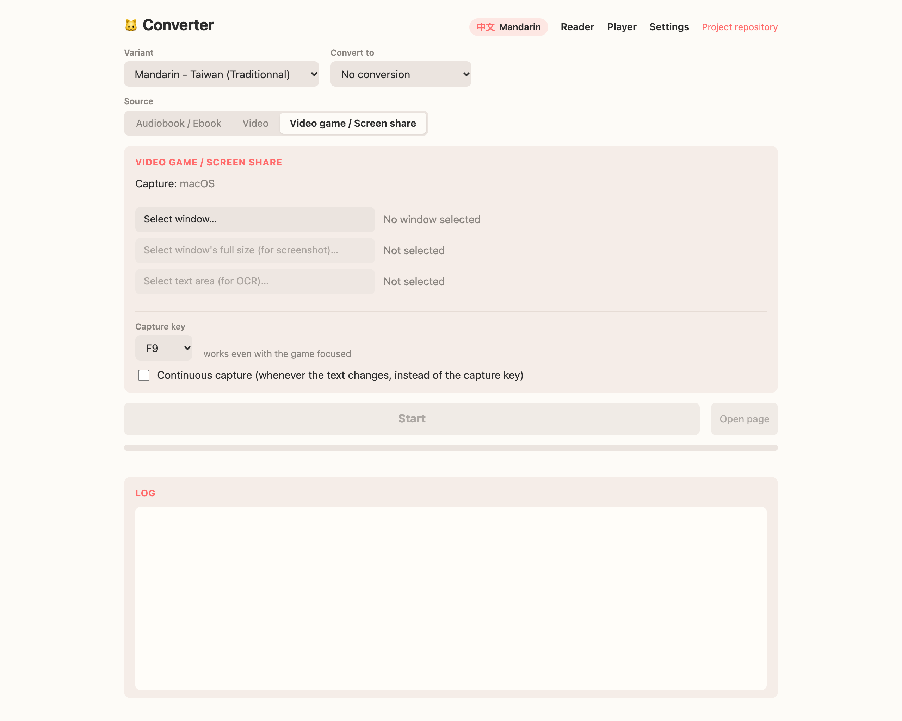

# Video games & screen share

Select **Video game / Screen share** as the **Source** at the top of the GUI to mine sentences from anything displayed in a window: a video game, a visual novel, a video call, a website... or from a **webcam / capture card**: a console or another computer plugged into an HDMI capture box.

MiningCat watches a window (or a camera), reads its text with OCR, and pushes the **screenshot + text** to a web page. Open that page next to your game, click a word to look it up in your [dictionaries](mining.md), and make an Anki card: the screenshot goes on the card. Yomitan or any other browser extension works on the page too.

Nothing is recorded in `output/`: everything lives in the page, while the capture runs.

## Supported systems

Window capture works very differently from one OS to another, so MiningCat picks the right implementation for yours automatically: it's the **Window** choice of the panel's **Capture** list. The other choice, **Webcam / capture card**, works the same on every OS (see [below](#webcam-or-capture-card)).

| System | Capture | Status |
| ------ | ------- | ------ |
| **Linux** | Desktop portal (ScreenCast) + PipeWire | Tested on Ubuntu, GNOME, Wayland |
| **macOS** | ScreenCaptureKit (macOS 14 or later) | Tested on macOS 15 |
| **Windows** | `PrintWindow` (GDI) | Tested on Windows 11 |
| **Webcam / capture card** (any OS) | OpenCV | Tested on macOS 15 with a MiraBox capture card |

### Linux setup

The capture goes through GNOME's screen sharing portal, which needs a few system packages:

```bash
sudo apt install python3-gi gir1.2-gst-plugins-base-1.0 gstreamer1.0-pipewire
```

These are system Python packages: your virtual environment must be able to see them. Create it with `--system-site-packages`:

```bash
python3 -m venv --system-site-packages .venv
make install
```

!!! info "Why the portal?"
    On GNOME/Wayland, classic screenshot tools (`grim`, X11 capture through Xwayland...) either don't work or return black images. The ScreenCast portal is the only reliable way, and it can remember your choice: GNOME asks you which window to share **once**, then MiningCat reopens it without any popup.

### macOS setup

The app you launch MiningCat from (Terminal, iTerm2, VS Code...) needs the **Screen Recording** permission:

1. The first time you click **Select window…**, macOS asks for the permission.
2. Open **System Settings > Privacy & Security > Screen & System Audio Recording** and enable that app.
3. Quit and reopen that app (the permission only applies after a restart), then launch MiningCat again.

The [capture key](#capture-key-or-continuous-capture) also needs the **Input Monitoring** permission for the same app (**System Settings > Privacy & Security > Input Monitoring**). macOS asks for it the first time you click **Start**.

### Windows setup

Nothing to install: capture uses the Windows API directly (`PrintWindow`), with no extra package or permission.

A handful of games using exclusive fullscreen DirectX, or protected by an anti-cheat, may capture as a black image: switch them to **windowed** or **borderless fullscreen** mode.

## Webcam or capture card

Pick **Webcam / capture card** in the **Capture** list to read a webcam, or a **capture card** (an HDMI capture box such as Elgato, MiraBox...): the way to mine a Switch, a PlayStation, or a game running on another computer.

- **macOS**: the app you launch MiningCat from (Terminal, iTerm2, VS Code...) needs the **Camera** permission. macOS asks for it the first time you click **Select camera…**; otherwise enable it in **System Settings > Privacy & Security > Camera**, then restart that app.
- **Linux**: nothing to install. Capture cards show up like webcams (`/dev/video*`).
- **Windows**: nothing to install. Cameras are listed by name when ffmpeg is installed, as "Camera 1", "Camera 2"... otherwise.

The camera is remembered by its name, so it's found again even if you plug other devices in. A camera can only be used by one app at a time: close OBS, or the capture card's own app, before starting the capture. MiningCat asks for full HD on Linux and Windows (drivers often default to a small size, too small for in-game text), and keeps the camera's own format on macOS.

!!! tip "Capture key"
    The capture key is listened to on the computer running MiningCat, not on the console: press it on that computer's keyboard, use the page's **Capture** button (from a phone or tablet too), or check **Continuous capture**.

## In the GUI



1. The game is in the language you study: pick its **Variant** if there are several (and **Convert to**, for Chinese).
2. Pick what to capture in the **Capture** list: the game's **Window**, or a **Webcam / capture card**.
3. Click **Select window…** and pick the game window:
    - **Linux**: GNOME's sharing dialog opens, pick the window there.
    - **macOS** and **Windows**: MiningCat lists the open windows in a dialog (**Refresh** if the game isn't there yet). The game must be open and not minimized.
    - **Webcam / capture card**: the button is **Select camera…**, and lists the cameras plugged in.
4. Click **Select window's full size (for screenshot)…** and draw a box around the part of the window you want to see in the page. It's pre-selected on the whole capture.
    - On **Linux**, the portal captures a screen-sized image with the window pasted on a black background: draw the box around the window's edges.
    - On **macOS** and **Windows**, the capture already is the window: keep it as is, or leave out the title bar or black borders.
    - With a **capture card**, the capture is the console's whole screen: keep it as is.
5. Click **Select text area (for OCR)…** and draw a box around the game's dialog box, where the text appears. It's pre-selected on the whole screenshot area, and **Reset to bottom third** is a good start for most games. Only this part is read by OCR, which makes it faster and avoids reading menus or the HUD.
6. Pick the **Capture key** (`F9` by default), or check **Continuous capture** (see [below](#capture-key-or-continuous-capture)).
7. Click **Start**. The page opens in a new tab of your browser (or click **Open page**).
8. Play, and press the capture key on each line you want to mine! Click **Stop** when you're done.

While the capture runs, the selection is locked and its log shows in the GUI's **Log** panel. Stopping MiningCat (`Ctrl+C` in its terminal) also stops the capture.

The window (or camera), the areas and the capture mode are remembered for next time, in `sources/game_ocr.json`. Selecting a new window resets the areas, and selecting a new screenshot area resets the text area (it's relative to the screenshot area).

!!! tip "Moving or resizing the window"
    Areas are stored as fractions of the window, so moving the window is fine, and resizing it keeps working as long as the game layout scales with it.

## Capture key or continuous capture

By default, MiningCat captures when you press the **capture key** (`F9`, or any key from `F1` to `F12`), even while the game is focused. The key still reaches the game.

- **macOS**: MiningCat listens to the key itself. It needs the Input Monitoring permission (see [macOS setup](#macos-setup)). On a Mac keyboard, `F1`-`F12` usually control the brightness, the volume... : press **fn** with the key, or enable **System Settings > Keyboard > Keyboard Shortcuts > Function Keys > Use F1, F2, etc. keys as standard function keys**.
- **Linux (GNOME)**: on Wayland, apps can't listen to the keyboard globally. While the capture runs, MiningCat registers a GNOME custom shortcut (named "MiningCat capture", visible in Settings > Keyboard) that sends the capture request, and removes it when you click **Stop**. Pick a key that isn't already used by another shortcut.
- **Windows**: MiningCat listens to the key itself, with a low-level keyboard hook (no extra permission needed).

Check **Continuous capture** to capture without pressing anything (the capture key is then greyed out): MiningCat looks at the text area twice per second, and runs OCR when it changed. Games often draw text letter by letter, so it waits until the text area stops changing before reading it, to avoid half sentences. It works best when nothing moves behind the text.

A capture is only pushed to the page when its text contains characters of the selected language (e.g. at least a Chinese character for Mandarin), and differs from the previous capture:

- with the **capture key**, it must not be exactly the same text (two real lines can differ by a single character);
- in **continuous capture**, it must not be the same line read again either, with the same rules as for [burned-in subtitles](video.md#burned-in-subtitles-ocr): a few characters misread (in proportion to the line length), a line of the dialog box missing, or lines read run together or in another order.

You can also capture at any time with the **camera button** at the top of the page, or with an HTTP request (e.g. from your own shortcut tool, or on a desktop where the capture key isn't supported):

```bash
curl -X POST http://127.0.0.1:6677/capture
```

## The page

Each capture shows the time, the time it took, the screenshot (dimmed until you hover it) and the text in a large font, ready to be mined.

With **Start** in the GUI, the page is MiningCat's own (<http://127.0.0.1:5050/game/>):

- the words are [coloured by status](mining.md#word-colours), and a click on a word opens the dictionary popup;
- **+ Card** opens the card creator with the capture's screenshot as the card's image;
- **Capture**: capture now. **Clear**: clear the history, in every open tab.

From the terminal (`game serve`), the capture has its own simpler page at <http://127.0.0.1:6677/>, without the dictionary: mine it with a browser extension, or with **copy image** (copies the screenshot to the clipboard, to paste it in your flashcard).

Both pages keep the history while the capture runs: reloading, or opening another tab, replays the last 20 captures.

## OCR

OCR is the same as for [burned-in subtitles](video.md#burned-in-subtitles-ocr): Apple Vision on macOS, EasyOCR elsewhere, in the selected language.

The lines of the dialog box are joined back together, since games wrap long sentences: without spaces for Chinese, Japanese and Cantonese, with spaces for other languages. **Convert to** converts Chinese characters, like for subtitles.

## From the terminal

```bash
python -m miningcat game setup                       # pick the window, then draw both areas in the browser
python -m miningcat game setup --webcam              # pick a webcam / capture card instead
python -m miningcat game serve --language japanese   # start capturing (F9), Ctrl+C to stop
python -m miningcat game serve --hotkey F2           # another capture key
python -m miningcat game serve --continuous          # continuous capture instead of the key
```

Or with make: `make game-setup`, then `make game LANGUAGE=japanese HOTKEY=F9`.

On macOS and Windows, `game setup` lists the windows and asks for a number, or use `--window` to pick the first window whose app name or title contains some text:

```bash
python -m miningcat game setup --window Ryujinx
python -m miningcat game setup --webcam --window MiraBox
```

See the [CLI reference](cli.md#game) for all options.

## Troubleshooting

- **"MiningCat needs the Screen Recording permission"** (macOS): see [macOS setup](#macos-setup). If you already enabled it, make sure you restarted the app you launch MiningCat from, and that it's the right one (e.g. VS Code, if you run `make gui` from its terminal).
- **"Window not found"** (macOS, Windows): the game was closed or minimized. Open it again: MiningCat finds it back by its app name and title. If its title changed, click **Select window…** again.
- **A captured frame is black** (Windows): some games using exclusive fullscreen DirectX, or protected by an anti-cheat, can't be captured this way. Switch them to windowed or borderless fullscreen mode.
- **"The permission may have been revoked"** (Linux): GNOME forgot the window you shared (e.g. after restarting the game). Click **Select window…** again.
- **Nothing shows up in the page**: check the log in the GUI. "no text detected" usually means the text area is wrong (select it again, a bit larger), or the selected **Language** doesn't match the game.
- **The capture key does nothing**: check the log. On macOS, grant the Input Monitoring permission and restart the app you launch MiningCat from, and press **fn** with the key. On GNOME, make sure no other shortcut uses the same key. The page's camera button always works.
- **"MiningCat needs the Camera permission"** (macOS, webcam / capture card): see [Webcam or capture card](#webcam-or-capture-card).
- **"Camera not found"**, **"Could not open"**, **"didn't send any image in time"** (webcam / capture card): check that it's plugged in and that no other app (OBS, the capture card's app, a video call...) is using it. If you renamed or replaced the device, click **Select camera…** again.
- **The capture card image is black or "no signal"**: check that the console is on and the HDMI cable connected. Some consoles (PlayStation) turn on HDCP, which capture cards can't record: turn it off in the console's settings.
- **"Address already in use"**: another capture is already running (maybe from a terminal). Stop it first. From the terminal, you can also use another port with `--port`.
